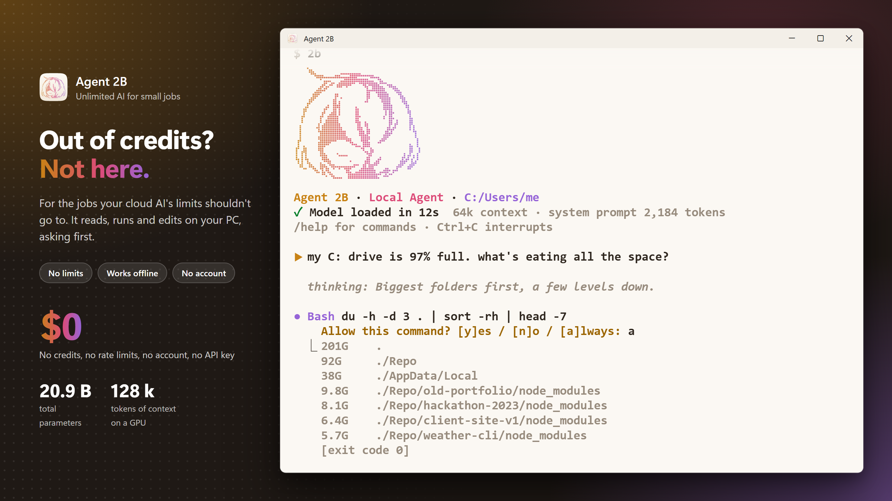
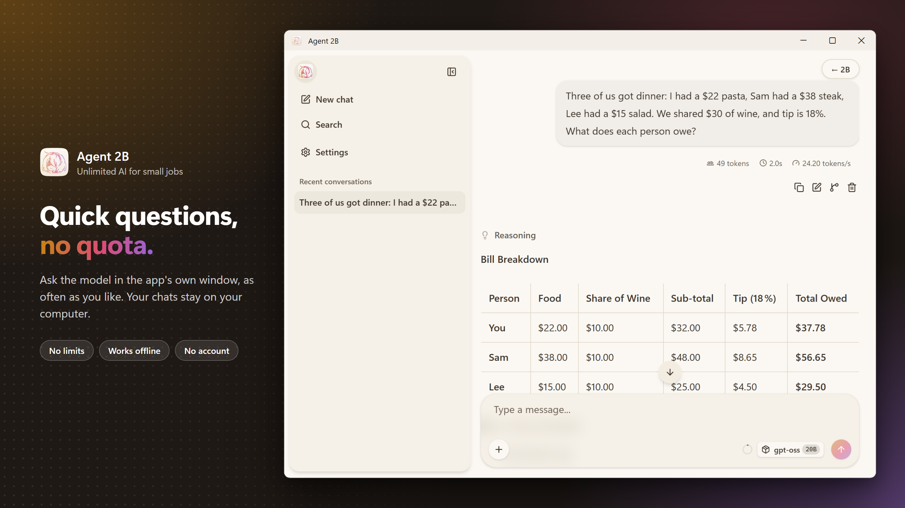
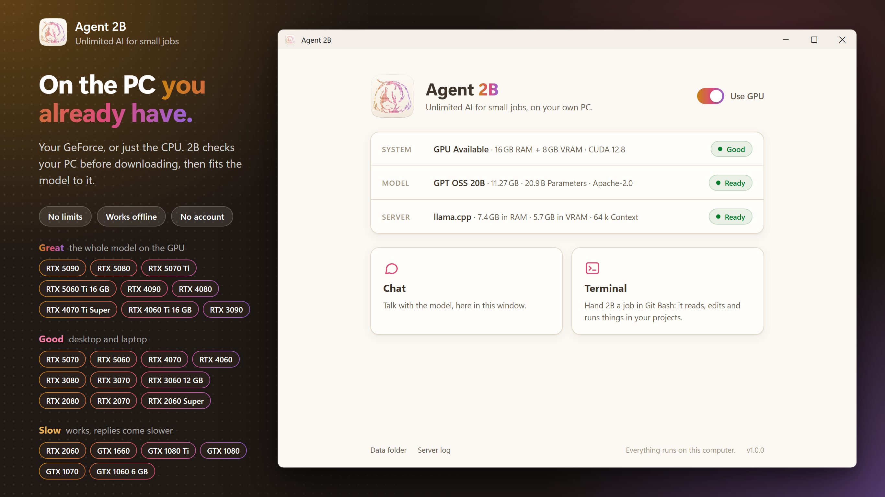

<div align="center">

  <br>

  <a href="https://github.com/chengmarc/agent-2b/releases/latest"></a>
  <a href="https://apps.microsoft.com/detail/9NCRP4F65JTF"></a>
  <a href="#try-it"></a>

  <h1>Agent 2B - Unlimited AI for Small Jobs</h1>

  <p><b>Out of credits? Not here.</b> A free AI on your own PC for the jobs your cloud AI's limits shouldn't go
  to: the commit message after a big rework, a quick search, a rename, an error you don't recognize.
  No limits, no account, nothing leaves your PC.</p>

  
  
  

</div>

## Demonstration

  

## Try it

You need Windows 10/11, **13 GB of free disk space** for the model, and either:
- **An NVIDIA GPU** (the fast way): 6 GB of VRAM or more, such as a GTX 1060 6 GB, a GTX 1660, or any desktop RTX.
  8 GB or more is better; with 16 GB the whole model fits on the GPU. GTX 10-series cards work but are slower. It
  needs a driver with CUDA 12.4 or later (CUDA itself doesn't need to be installed), and **16 GB of RAM** (8 GB with
  a 12 GB GPU) for the part of the model the GPU can't hold.
- **Or just the CPU**: any 64-bit x64 CPU with **16 GB of RAM**. It works, but replies come much slower than on a
  GPU.

1. **Download `Agent-2B-portable.zip`** from the [latest release](https://github.com/chengmarc/agent-2b/releases/latest)
   and unzip it anywhere, a flash drive included. It holds portable Git Bash, Node.js and llama.cpp (CUDA build).
2. **Double-click `2B.exe`.** The 2B window checks your PC first: GPU Available or CPU Only, and whether 2B runs
   on it (Great, Good or Slow), or why not, before anything is downloaded. With a GPU, **Use GPU** at the top right is
   on; turn it off to keep the GPU free (for a game, say) and run 2B on the CPU.
3. **Click Download model** the first time. It downloads gpt-oss-20b (12 GB) into `data/` beside `2B.exe`. If it's
   interrupted, click Resume download, even after a restart. It uses the Windows proxy setting if one is on.
4. **Click Chat or Terminal.**
   - **Chat** talks with the model in the same window, using llama.cpp's own chat page. **← 2B** at the top right
     goes back.
   - **Terminal** opens Git Bash in your home folder with 2B running, ready for a job in your files. `/exit` leaves a normal
     prompt: `cd` into a project and type `2b` to work there.

Loading the model takes about 30 s on a GPU. llama.cpp splits it between GPU and CPU to fit whatever VRAM is free at
that moment, so there is nothing to configure per computer. Chat and every terminal share one model server, which stops
when the last 2B window closes.

## What it can do

The model works through eleven tools. Anything that changes a file, runs a command or fetches a page asks first
(`y` / `n` / `a` for always); after a `n` you can tell it why. `a` covers edits, writes and fetches for the rest of the
session, never commands: a command always asks. A command that deletes anything outside the project folder (or the
folder itself) is refused before it runs.

| Reads, no asking | Asks first |
|---|---|
| Read, Glob, Grep, WebSearch | Edit, Write (shown as a diff), Bash, PowerShell, WebFetch |
| Git, GitHub (`gh`) when read-only | Git, GitHub when they change something |

It reads the project's `AGENTS.md` or `CLAUDE.md`, streams its reasoning dimmed, and renders answers as markdown.
In the agent: `/clear` starts over, `/effort low|medium|high` sets reasoning effort, `/tokens` shows context used
(128k on the GPU, 64k on the CPU), `/prompt` shows the exact text the model reads, `/exit` quits.

**Know the limits:** it's a 20B model (about 3.6B active per token), made for small jobs, not to replace your
cloud AI. Give it tight, scoped tasks in a codebase or on the machine, and keep the big, open-ended ones for the
cloud.

## Change it

2B is three layers, each in one language: the app, `2B.exe`, in C#; the agent in TypeScript, run as is by Node with
no npm packages; and the tools that build it in PowerShell. Everything the model reads is a text file in
[`src/agent/prompt/`](src/agent/prompt/), and each tool is one file in [`src/agent/tools/`](src/agent/tools/).

In a clone, download the runtimes into `src/runtime/` once and build `src/2B.exe`:

```powershell
powershell -ExecutionPolicy Bypass -File packaging\fetch.ps1
powershell -ExecutionPolicy Bypass -File packaging\build.ps1 -Exe
```

[`src/README.md`](src/README.md) explains the layers, [`src/agent/README.md`](src/agent/README.md) covers changing the
agent, and [`docs/RELEASING.md`](docs/RELEASING.md) covers building and publishing.

## License

[Apache 2.0](LICENSE)
