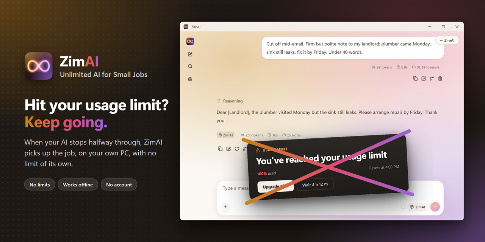
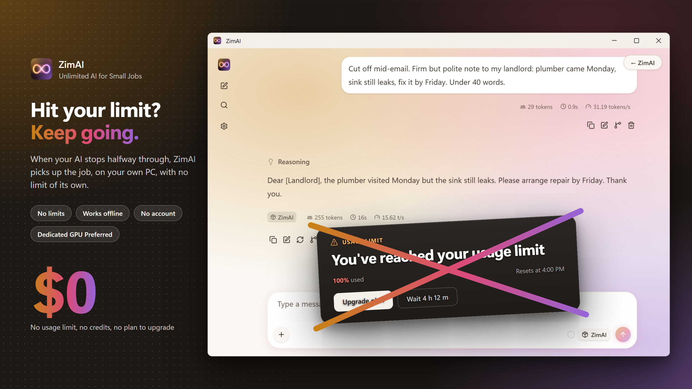
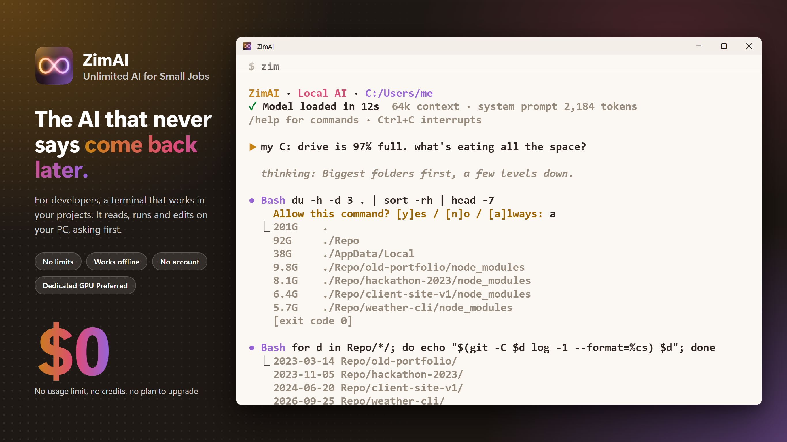

   

  
  
  

  <h1>ZimAI - Unlimited AI for Small Jobs</h1>

  

## Screenshots

## Demonstration

  

## Try it

1. Download `ZimAI-portable.zip` from the [latest release](https://github.com/chengmarc/ZimAI/releases/latest) and
   unzip it anywhere.
2. Double-click `ZimAI.exe`. It checks your PC before downloading anything.
3. Click **Download** (the 12 GB model, once), then **Start**.
4. Click **Chat**, or **Terminal** for jobs in your files.

## What it can do

- **Chat:** emails, rewrites, formulas and quick questions, in the app's own window.
- **Terminal:** reads, edits and runs things in your projects, and asks before every change or command.
- **Know the limits:** it's a 20B model, made for small jobs, not to replace the AI you pay for.

## License

[Apache 2.0](LICENSE)
