   

  
  

  <h1>Agent 2B - AI in your Flash Drive</h1>
  
  

  

## Try it

You need Windows 10/11 and an NVIDIA GPU (an RTX 5060 or better) whose driver supports CUDA 12.4 or later (`nvidia-smi` shows the version).
CUDA itself doesn't need to be installed.

1. **Download `Agent-2B-portable.zip`** from the [latest release](https://github.com/chengmarc/agent-2b/releases/latest)
   and unzip it anywhere, a flash drive included. It holds portable Git Bash, Node.js and llama.cpp (CUDA build).
2. **Double-click `2B.exe`.** The 2B window shows your GPU and the model.
3. **Click Download model** the first time. It downloads gpt-oss-20b (12 GB) into `data/` beside `2B.exe`. If it's
   interrupted, click Resume download, even after a restart. It uses the Windows proxy setting if one is on.
4. **Click Chat or Terminal.**
   - **Chat** talks with the model in the same window, using llama.cpp's own chat page. **← 2B** at the top right
     goes back.
   - **Terminal** opens Git Bash in your home folder with the 2B coding agent running. `/exit` leaves a normal
     prompt: `cd` into a project and type `2b` to work there.

Loading the model takes about 30 s. llama.cpp splits it between GPU and CPU to fit whatever VRAM is free at that
moment, so there is nothing to configure per computer. Chat and every terminal share one model server, which stops
when the last 2B window closes.

## What it can do

The model works through eleven tools. Anything that changes a file, runs a command or fetches a page asks first
(`y` / `n` / `a` for always); after a `n` you can tell it why.

| Reads, no asking | Asks first |
|---|---|
| Read, Glob, Grep, WebSearch | Edit, Write (shown as a diff), Bash, PowerShell, WebFetch |
| Git, GitHub (`gh`) when read-only | Git, GitHub when they change something |

It reads the project's `AGENTS.md` or `CLAUDE.md`, streams its reasoning dimmed, and renders answers as markdown.
In the agent: `/clear` starts over, `/effort low|medium|high` sets reasoning effort, `/tokens` shows context used
(64k total), `/prompt` shows the exact text the model reads, `/exit` quits.

**Know the limits:** it's a 20B model (about 3.6B active per token). It's good at small, scoped tasks in a codebase
or on the machine; give it tight tasks rather than open-ended ones.

## Change it

The agent is plain TypeScript run directly by Node: no build step, no npm packages. Everything the model reads is a
text file in [`src/agent/prompt/`](src/agent/prompt/), and each tool is one file in [`src/agent/tools/`](src/agent/tools/).
In a clone, run `tools\fetch.cmd` once to download the runtimes into `src/runtime/`, and
`src/runtime/node/node.exe tools/build.ts --exe` to build `src/2B.exe`.
[`src/agent/README.md`](src/agent/README.md) covers running a change, adding a tool, upgrading a component and swapping the
model.

## License

[Apache 2.0](LICENSE)
